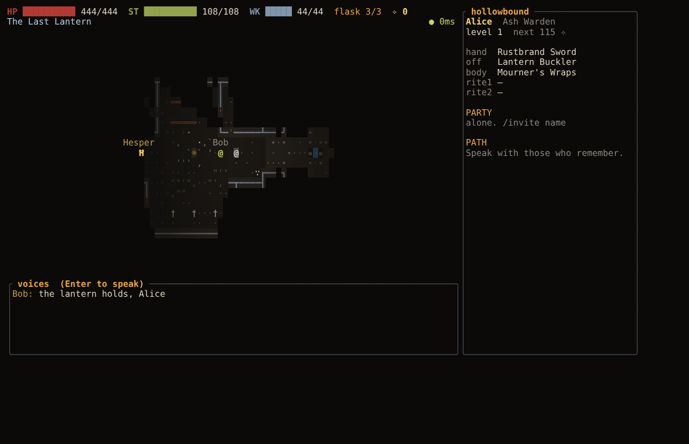
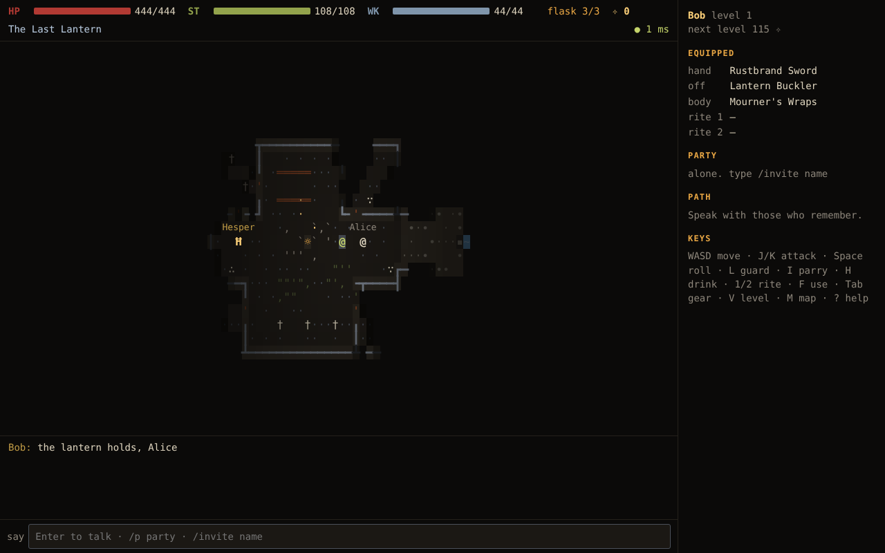

# HOLLOWRITE

*Death keeps what you forget.*

A persistent online dark-fantasy action RPG drawn entirely in text. One
authoritative Rust server hosts a single shared world; players join it from a
native **terminal client** or a **browser client** and see each other, fight
the same enemies and share the same boss.

> Working title. A separate Minecraft roleplay community uses the name
> "HollowRite"; no trademark clearance has been done and the name is easy to
> change (see `docs/ARCHITECTURE.md#renaming`).

| terminal (Ratatui) | browser (Canvas 2D) |
|---|---|
|  |  |

Both captures were taken at the same moment from the same server: Alice is on
the terminal, Bob in Chromium, and Bob's chat line reached both.

## What exists right now

This is a **vertical slice**, not a finished MMO. What is implemented, tested
and runnable today:

- Authoritative 30 Hz world simulation with 15 Hz interest-managed snapshots.
- Accounts (Argon2id), sessions, character creation with three origins and
  appearance choices, and up to four characters per account.
- Real-time combat: light and heavy attacks, dodge roll with invulnerability
  frames, guard, parry with riposte criticals, stagger and poise, healing
  draughts, two rites (a bolt and an area toll), stamina and wick.
- Three enemy types with distinct behaviour and telegraphs, and the two-phase
  Bell-Mother with shockwave rings, lingering hazards and a vulnerability
  window, scaled for co-op and run in a sealed shared arena.
- One connected level: the Last Lantern sanctuary, Gloamreach (streets and ash
  orchard), the Ossuary and the belfry, with three lanterns, a locked gate, two
  one-way shortcuts and a hidden grove.
- Three NPCs, a two-quest chain with a meaningful final choice, items,
  equipment, levelling, death that drops your echoes where you fell, and
  reclaiming them.
- Parties (up to four), local and party chat, mute and report.
- Persistence of the full character aggregate in PostgreSQL with versioned,
  transactional saves and an economic ledger; survives disconnects and server
  restarts.

Known gaps and deferred features are listed in
[docs/MILESTONES.md](docs/MILESTONES.md). Nothing in that list is pretended to
work.

## Quick start (local)

Requirements: Rust stable 1.87+, Node.js 20 or 22, and PostgreSQL 16 (Docker
Compose is the easy route; a native install also works).

```bash
cp .env.example .env
make check-env          # what is installed, is the database up, are ports free
make db-up              # PostgreSQL via Docker, or a local cluster in .data/pg
make web-install        # pinned web dependencies (npm ci)
make migrate            # create the schema
make dev                # game server on :7700 and web client on :5173
```

Open <http://127.0.0.1:5173>, create an account and a character.

In a second terminal:

```bash
make dev-terminal       # terminal client, same server
```

The terminal client needs at least **80×24** cells and looks best at
**120×35** or larger with a font that has box-drawing glyphs (DejaVu Sans
Mono, Cascadia Mono, JetBrains Mono, Iosevka, Menlo).

Without Make, every target is a one-line command; see the `Makefile`.

### Running the built web client from the game server

```bash
make release
HOLLOWRITE_WEB_DIR=apps/web/dist target/release/hollowrite-server
# browser: http://127.0.0.1:7700   terminal: target/release/hollowrite
```

## Playing

| key | action |
|---|---|
| `W A S D` / arrows | move (`Q E Z C` for diagonals; the browser also accepts two keys at once) |
| `J` / `K` | light / heavy attack (turns toward a foe in reach) |
| `Space` | dodge roll |
| `L` | guard (hold; toggles in terminals that cannot report key release) |
| `I` | parry (needs a shield) |
| `H` | drink a tallow draught |
| `1` / `2` | cast prepared rites |
| `F` | talk, rest at a lantern, open doors, touch suspicious walls |
| `Tab` · `V` · `M` | gear and quests · invest echoes · map |
| `Enter` | chat (`/p` party, `/invite`, `/accept`, `/leave`, `/mute`, `/report`) |
| `Esc` | menu: ASCII glyphs, colours, contrast, motion, input mode, leave |
| `?` | help and telegraph legend |

A `!` over an enemy means it is winding up. The tinted cells show exactly where
the attack will land, and they brighten as it gets closer to hitting. The
shape of each glyph carries the meaning, so colour is never the only cue.

Terminal options: `--ascii`, `--colors 24bit|256|16`, `--high-contrast`,
`--reduced-motion`, `--input auto|hold|repeat`, `--no-remember`.

## Tests

```bash
make test        # Rust unit/simulation/content tests + web typecheck and tests
make test-db     # PostgreSQL and full HTTP/WebSocket end-to-end tests
make lint        # rustfmt, clippy -D warnings, eslint
make smoke       # two protocol bots against a running server
make latency     # input-to-ack latency through a 150 ms RTT proxy
make load        # 20 wandering bots for 30 s
```

Measured results and what each suite covers are in
[docs/TEST_PLAN.md](docs/TEST_PLAN.md).

## Documentation

- [Game design](docs/GAME_DESIGN.md) and [content manifest](docs/CONTENT_MANIFEST.md)
- [Architecture](docs/ARCHITECTURE.md) and [decision records](docs/ADR/)
- [Network protocol](docs/NETWORK_PROTOCOL.md)
- [Content pipeline](docs/CONTENT_PIPELINE.md) and [style guide](docs/STYLE_GUIDE.md)
- [Security](docs/SECURITY.md) and [operations](docs/OPERATIONS.md)
- [Test plan and results](docs/TEST_PLAN.md)
- [Milestones, risks and limitations](docs/MILESTONES.md)

## Repository layout

```
crates/protocol         versioned wire types shared by everything
crates/game-core        deterministic simulation: world, combat, AI, rules
crates/persistence      PostgreSQL repositories and migrations runner
crates/server           Axum HTTP + WebSocket server, world actor, auth
crates/terminal-client  Ratatui/Crossterm client (binary: hollowrite)
crates/test-support     protocol bots, latency proxy, smoke/load tools
apps/web                Vite + React + Canvas 2D browser client
content/                map, balance, items, actors, dialogue, palette
db/migrations           SQL migrations
docs/                   design, architecture, ADRs, operations, test results
scripts/                environment checks, database, dev and capture helpers
```

## License

Code and original content are dual licensed under MIT or Apache-2.0, at your
option. See [LICENSE-MIT](LICENSE-MIT) and [LICENSE-APACHE](LICENSE-APACHE).
No third-party game assets, lore or names are used.
